<p align="center">
  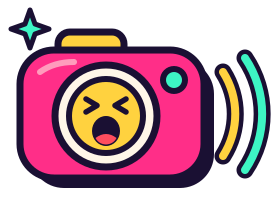
</p>

<h1 align="center">Yellfie</h1>

<p align="center">
  <b>Party games you play with your voice, your face and your whole body.</b><br>
  Your microphone and webcam are the controllers. Everything runs in the browser.
</p>

<p align="center">
  <a href="LICENSE"></a>
  
  
  
  
</p>

<p align="center">
  <a href="#quick-start">Quick start</a> •
  <a href="#install-as-an-app">Install as an app</a> •
  <a href="#the-games">Games</a> •
  <a href="#troubleshooting">Troubleshooting</a> •
  <a href="#adding-a-new-game">Add a game</a> •
  <a href="#contributing">Contributing</a>
</p>

<p align="center">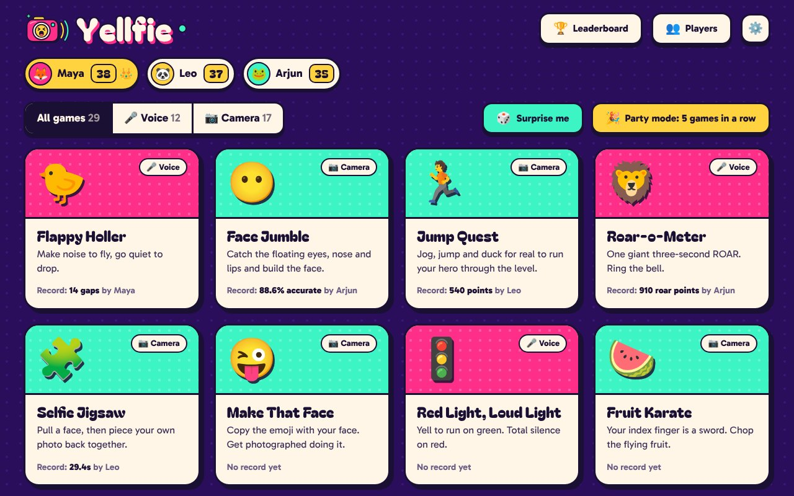</p>

---

## Table of contents

- [About](#about)
- [Features](#features)
- [Screenshots](#screenshots)
- [Quick start](#quick-start)
- [Install as an app](#install-as-an-app)
- [The games](#the-games)
- [Scoring](#scoring)
- [Settings](#settings)
- [Keyboard shortcuts](#keyboard-shortcuts)
- [Browser support](#browser-support)
- [Deploying](#deploying)
- [Privacy](#privacy)
- [Troubleshooting](#troubleshooting)
- [Development](#development)
- [Contributing](#contributing)
- [License](#license)
- [Acknowledgements](#acknowledgements)

## About

Yellfie is a pack of 29 short party games for a group around one laptop or TV. Players type their names, then take turns in front of the screen. They shout to fly a bird, hum to steer a rocket, pull faces to match emoji, slice fruit with a fingertip, pinch floating eyes and lips onto a blank face, race to rebuild a jigsaw of their own selfie, and jog and jump for real to run a hero through a platform level. Each round ends on a podium and adds to a party leaderboard.

There is **no server, no account and no database**. It's a static web page: camera frames and audio are analysed locally with [MediaPipe](https://developers.google.com/mediapipe) (WebAssembly) and the Web Audio API.

## Features

- **29 games**: 12 controlled by voice, 17 by camera (face, body and hand tracking, including pinch and finger-counting gestures).
- **Players and party points**: add names and an animal avatar, then watch the standings update after every game. Scores persist in the browser until you reset them.
- **Turn-based hot seat**: a "you're up" card, a 3-2-1 countdown, a score card with a quip, then the next player.
- **Same or different challenges**: give every player identical faces, poses, walls or rhythms for a fair fight, or a fresh set each for variety. Challenges aren't repeated until the pool runs out.
- **Photo booth**: camera games capture each player's funniest moment. You can save them, and they vanish when the tab closes.
- **Party mode**: five random games back to back, ending with a champion. **Surprise me** picks one game at random.
- **Crowd jobs**: every game gives the people watching something to do.
- **Announcer, sounds and effects**: an optional spoken host, synthesised sound effects (no audio files), confetti and screen shake.
- **Tracking outlines**: an optional overlay of your hand skeleton, face outline and arms, so players can see what the camera sees.
- **Installable app (PWA)**: add it to your home screen, dock or apps list. It opens full screen with its own icon and works offline.
- **Keeps the screen awake** during the party, so phones don't dim or lock mid-game.
- **No build step**: plain HTML, CSS and ES modules. Every game is one file.

## Screenshots

| | |
|:---:|:---:|
| 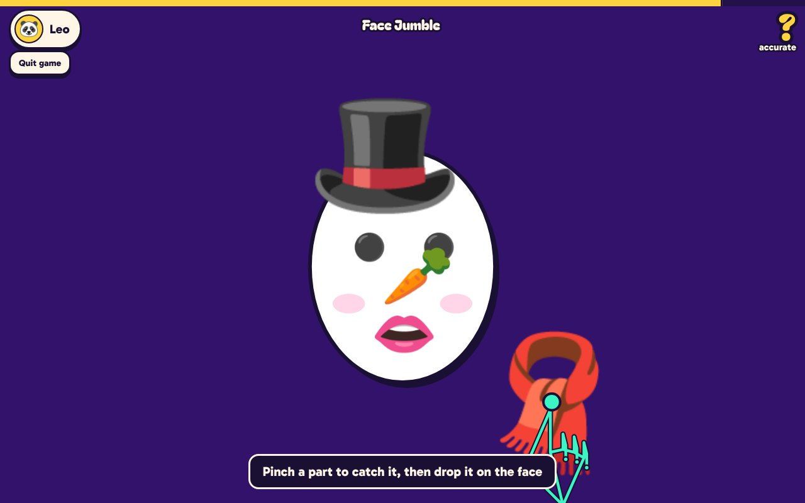<br>Face Jumble | 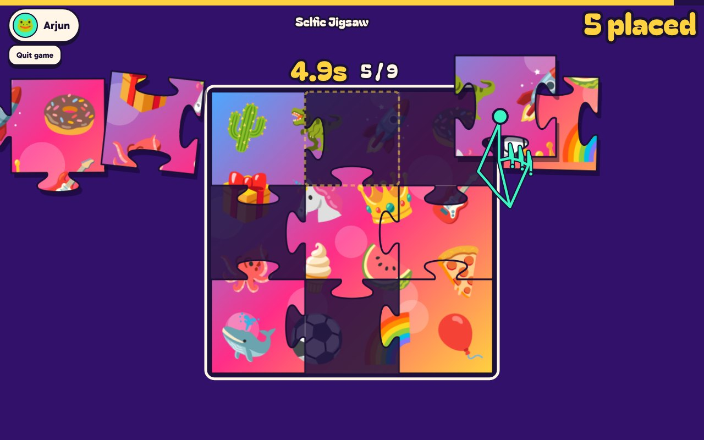<br>Selfie Jigsaw |
| 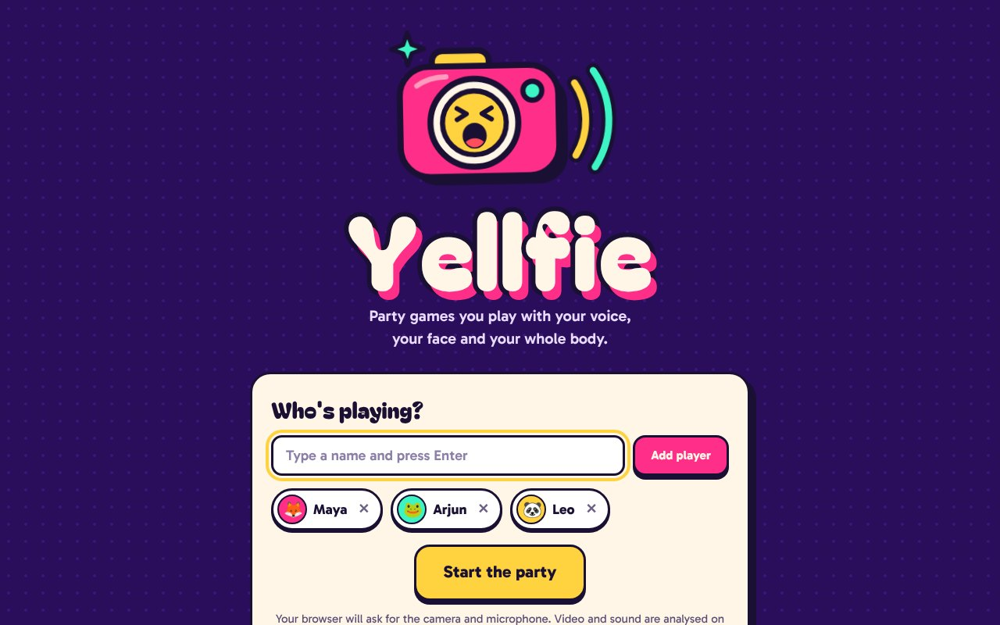<br>Add the players | 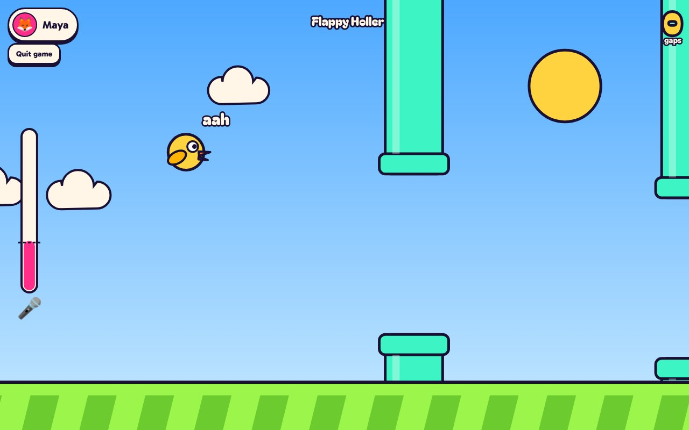<br>Flappy Holler |
| 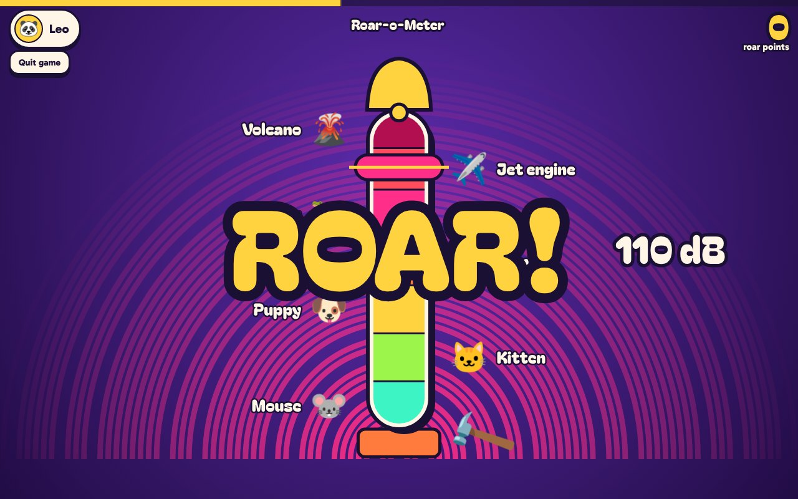<br>Roar-o-Meter | 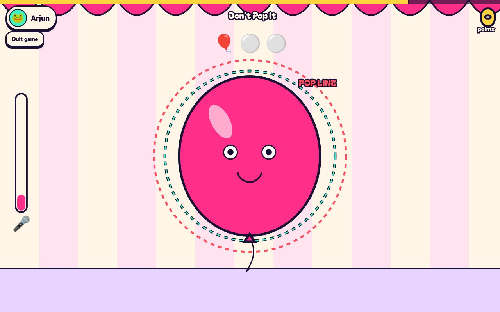<br>Don't Pop It |
| 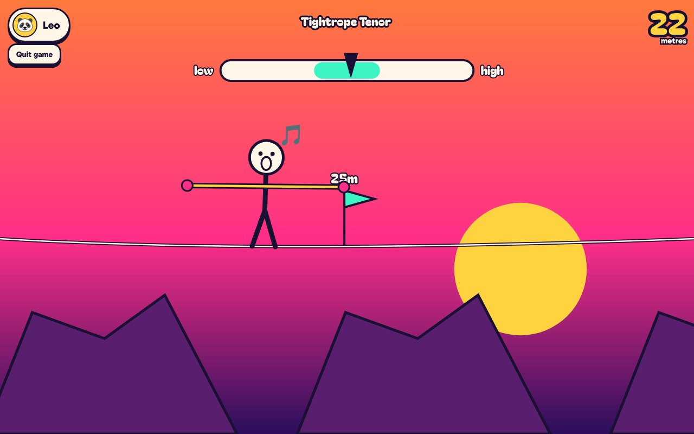<br>Tightrope Tenor | 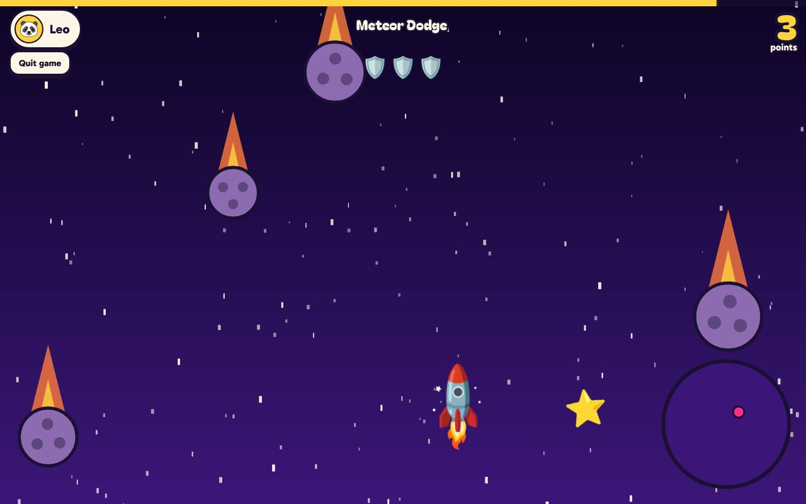<br>Meteor Dodge |
| 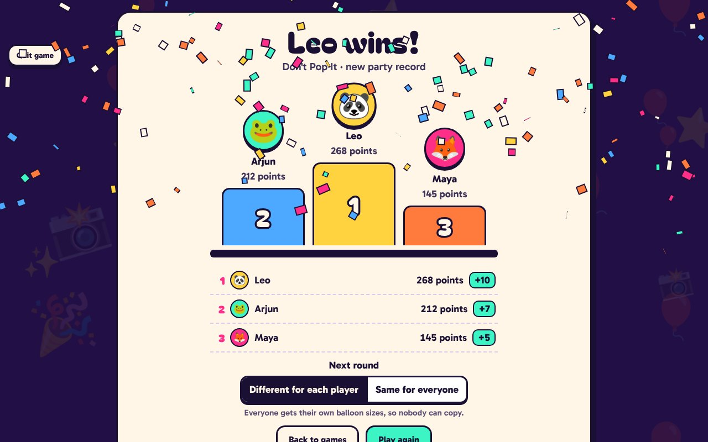<br>Results podium | 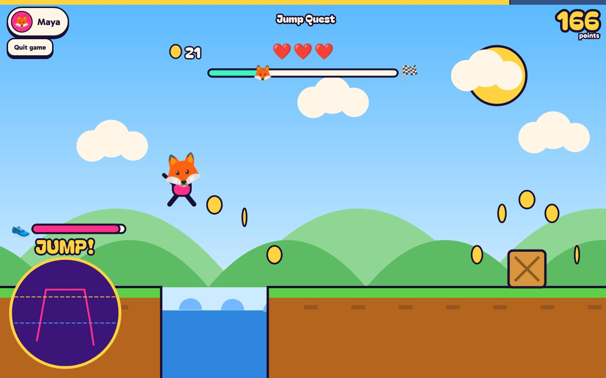<br>Jump Quest |

## Quick start

### Requirements

- A recent desktop browser. Chrome or Edge is recommended (see [Browser support](#browser-support)).
- A webcam and a microphone. A laptop's built-in ones are fine.
- Python 3 **or** Node.js 18+, only to run a tiny local web server.

### Run locally

Browsers only allow camera and microphone access on `https://` pages or on `localhost`, so serve the folder rather than opening `index.html` directly.

```bash
git clone https://github.com/khjabir/yellfie.git
cd yellfie

# pick one
python3 -m http.server 8080
npm start                      # uses `npx serve` on port 8080
```

Open **http://localhost:8080**. If something else uses that port, choose another one (e.g. `python3 -m http.server 8090`).

### Play

1. Type each player's name and press <kbd>Enter</kbd>. Tap an avatar to change the animal.
2. Press **Start the party** and allow the camera and microphone.
3. Pick a game, or press **Surprise me** or **Party mode**.
4. Read the instructions card, press **Start**, and follow the "you're up" prompts.

**Room setup tips:** put the laptop on a table, mirrored to a TV if you can. Lean in for face and voice games, and stand about two steps back for body games. Good front lighting makes face tracking far more reliable.

## Install as an app

Yellfie is a Progressive Web App, so you can install it like a regular app. It opens full screen, gets its own icon and keeps working without internet.

| Device | How to install |
| --- | --- |
| Android (Chrome, Edge, Samsung Internet) | Tap **📲 Install app** in the lobby, or the browser menu → *Install app* / *Add to Home screen*. |
| iPhone / iPad (Safari) | Tap **📲 Install app** for the steps: *Share* → *Add to Home Screen* → *Add*. |
| Windows, macOS, Linux (Chrome, Edge) | Click **📲 Install app**, or the install icon in the address bar. |
| macOS (Safari 17+) | *File* → *Add to Dock*. |

Installing needs the site to be served over `https://` (or `localhost`).

### Offline play

- **After the first visit**, the app itself and the **voice games** work offline (except Tongue Twister Turbo and Blurt It!, which need the browser's online speech recognition).
- **Camera games** also need their trackers (about 32 MB). Each one is saved the first time you play a game that uses it. To save them all at once, use **Settings → Offline play → Download for offline**. Nothing large is downloaded unless you need it.

### Updates and performance

The service worker is built to cost nothing when you're online and never serve outdated code:

- **Online**, the browser loads the app exactly as it would without a service worker, so updates show up straight away. After each load, while the browser is idle, the service worker keeps a copy of the files the page just used, for offline play.
- **Offline**, it serves that copy.
- **The tracker files** (pinned versions) are served from the cache once saved, so camera games start faster.

Measured side by side (median of 9 reloads, two rounds): page-ready time stayed within about ±12 ms of the version without a service worker, which is measurement noise. Tracker files loaded 15–27% faster. On a real connection the tracker saving is bigger, because cached files are never re-checked or re-downloaded.

## The games

### 🎤 Voice games

| Game | What you do | What it listens for |
| --- | --- | --- |
| 🐤 **Flappy Holler** | Make any sound to fly up, go quiet to drop, and pass through the gaps. | Loudness |
| 🚀 **Pitch Pilot** | Sing your lowest and highest notes to calibrate, then hum to steer a rocket through asteroid gates. | Pitch |
| 🎈 **Don't Pop It** | Blow or hum a balloon up to a target ring, then go quiet to tie it off. Balloon 3 hides the ring. | Sustained loudness |
| 🦁 **Roar-o-Meter** | One three-second roar on a fairground strength tester. Hit 880 to ring the bell. | Absolute loudness |
| 🎶 **Tightrope Tenor** | Hold one steady note to keep walking. Wobble or run out of breath and you fall. | Pitch stability |
| 👏 **Clap Back** | Listen to a rhythm, then clap it back. Four rounds, each harder. | Clap timing |
| 👅 **Tongue Twister Turbo** | Say a tongue twister once, fast and accurately. | Speech recognition |
| 🚦 **Red Light, Loud Light** | Yell to run while the light is green. Any sound on red and the guard sends you back. | Loudness, on and off |
| 🐉 **Don't Wake the Dragon** | Whisper to tiptoe through the cave. Cross the red line and the dragon wakes. | Quiet control |
| 🎼 **Sing It Back** | Hear a note, sing it back and hold it. Any octave counts. | Pitch accuracy |
| 💬 **Blurt It!** | Shout as many fruits, animals or countries as you can in 15 seconds. | Speech recognition |
| 🐸 **Hup Hop** | Short shouts make a frog jump the logs. Stay quiet under the bees. | Sound bursts |

### 📷 Camera games

| Game | What you do | What it tracks |
| --- | --- | --- |
| 😜 **Make That Face** | Copy five emoji with your face. Your best attempt is photographed. | 52 facial expression scores |
| 💃 **Strike a Pose** | Match a glowing arm pose drawn on top of you. Sometimes it's a YMCA medley. | Arm angles |
| 🧱 **Hole in the Wall** | A wall with a body-shaped hole flies at you. Fit through it. | Body position |
| 🍉 **Fruit Karate** | Your index finger becomes a glowing sword (fingertip, small, medium or large). Slice fruit, avoid bombs. | Fingertips (both hands) |
| 🍩 **Chomp Champ** | Move your head and open wide to eat falling snacks. Avoid chillies and socks. | Mouth position and opening |
| 👀 **Staring Contest** | Don't blink while the game throws flies, ghosts and fake-outs at you. | Eye blinks |
| 😐 **Poker Face** | Keep a straight face while the screen gives you googly eyes and a moustache. | Smile and jaw |
| 🧙 **Simon Says** | Obey the spoken commands, but only when Simon says so. | Body pose and fingertips |
| ☄️ **Meteor Dodge** | Steer a rocket with your head to dodge meteors. | Head position |
| 😶 **Face Jumble** | Pinch the floating eyes, nose and lips and drop them on a blank face. The most accurate face wins. | Pinch gesture (both hands) |
| 🧩 **Selfie Jigsaw** | Pull a face for a photo, then pinch and drag the jigsaw pieces back together. Fastest finish wins. | Pinch gesture (both hands) |
| ⚽ **Header Hero** | Keep a ball in the air with your head. Five in a row and headers count double. | Head position and speed |
| 🐔 **Wing It** | Flap your arms like wings to fly a chicken through the gaps. | Arm sweeps |
| 🕺 **Freeze Dance** | Dance while the music plays, freeze like a statue when it stops. | Body movement |
| ✌️ **Rock Paper Scissors** | Beat the robot over five rounds with a real hand. | Hand shapes |
| 🖐️ **Finger Maths** | Answer quick sums by holding up the right number of fingers. | Finger counting (both hands) |
| 🏃 **Jump Quest** | A side-scrolling platformer you play with your body: jog on the spot to run, jump for real to clear crates, pits and critters, crouch to duck under bats. Reach the flag in 60 seconds. | Arm and knee pumping, shoulder height |

## Scoring

Every game ranks the round's players and awards **party points**:

| Place | 1st | 2nd | 3rd | 4th | 5th | Everyone else |
| --- | :-: | :-: | :-: | :-: | :-: | :-: |
| Points | 10 | 7 | 5 | 3 | 2 | 1 |

- Ties share a place.
- A score of zero earns 1 point and never counts as a win.
- Each game keeps a **party record** (best score and who set it), shown on its tile.
- Two games score differently on screen but rank the same way: **Selfie Jigsaw** shows your solving time (fastest wins; unfinished puzzles rank by pieces placed), and **Face Jumble** shows accuracy as a percentage.
- **Jump Quest** adds up 2 points a metre, 5 a coin, 15 for each critter you land on, and a bonus for reaching the flag (100 plus 5 for every second left).
- Players, points, wins and records are stored in `localStorage` until you use **Reset scores** or **End party** in Settings. Photos are kept in memory only.

## Settings

Open the ⚙️ button in the lobby.

| Setting | What it does |
| --- | --- |
| Announcer voice | Reads out whose turn it is and who won (browser text-to-speech). |
| Sound effects / Game volume | Turns the synthesised sounds on or off and sets their volume. |
| Mic sensitivity | Raise it if the voice games don't react; lower it in a loud room. Each voice game also measures background noise during the countdown. |
| Mic check / Camera check | A live level meter and camera preview. |
| Keep screen awake | On by default. Stops phones, tablets and laptops from dimming or locking during the party (Screen Wake Lock API). The note under it shows whether your browser allowed it. |
| Show tracking outlines | Draws your hand skeleton, face outline and arms during camera games. |
| Install as an app | Shows whether Yellfie is installed, with an **Install** button where the browser supports it. |
| Offline play | Shows how many trackers are saved, with **Download for offline** to save all of them (about 32 MB). |
| Challenges in a round | **Different for each player** (default) or **Same for everyone**, for the games with set challenges (faces, poses, rhythms, puzzles and so on). You can also switch it per game on its start screen or the podium. |

Some games also have their own options on their start screen (and on the podium before **Play again**), remembered between parties. For example: Fruit Karate's **Sword length**, Selfie Jigsaw's **Pieces** (6 to 16) and **Picture**, Face Jumble's **Guide marks**, and Sing It Back's **Tuner**.
| Reset scores / End party | Reset keeps the players and clears points, records and photos. End party removes everything. |

## Keyboard shortcuts

| Key | Action |
| --- | --- |
| <kbd>Enter</kbd> or <kbd>Space</kbd> | Press the highlighted button on any card (Start, I'm ready, Next up…). |
| <kbd>Esc</kbd> | Quit the current game, or close a dialog. |

## Browser support

Yellfie is developed and tested in **Google Chrome** on desktop. The other browsers below use the same web standards (`getUserMedia`, Web Audio, WebGL/WebAssembly) and are expected to work, but haven't been tested yet.

| Browser | Status |
| --- | --- |
| Chrome / Edge (desktop) | ✅ All 29 games |
| Safari (macOS) | Expected to work, untested |
| Firefox | Expected to work except **Tongue Twister Turbo** and **Blurt It!**, which need the Web Speech API that Firefox lacks |
| Phones and tablets | Works and can be installed as an app; the layout keeps clear of notches. The games are designed for a laptop-sized screen viewed from a few steps away, so a tablet or phone propped up works best |

## Deploying

Yellfie is a static site, so any static host works: GitHub Pages, Netlify, Vercel, Cloudflare Pages or your own server. It must be served over **HTTPS**, or browsers will block the camera, microphone, installing and offline mode. It works from a sub-path such as `/yellfie/`, because every path is relative.

**GitHub Pages:** in the repo open *Settings → Pages*, choose *Deploy from a branch*, and pick `main` / root. The game will be live at `https://khjabir.github.io/yellfie/`. The bundled files in `vendor/` are each well under GitHub's 100 MB file limit.

### Bundled tracking files (`vendor/`)

The MediaPipe library and the face, body and hand models (~32 MB) are kept in `vendor/` so the app works offline. If you'd rather not commit them, add `vendor/` to `.gitignore`. The app then loads the same pinned files from the jsDelivr and Google CDNs automatically, and the service worker caches those too. To download them again:

```bash
npm run vendor
```

If you ever **change** the files in `vendor/` (for example a newer MediaPipe), bump the `TRACKERS` cache name at the top of `sw.js` (and in `js/pwa.js`) so installed copies pick up the new files.

## Privacy

- Camera frames and microphone audio are processed **locally** in your browser by JavaScript and WebAssembly. Nothing is recorded, stored on a server or sent anywhere.
- **Exception:** Tongue Twister Turbo and Blurt It! use the browser's built-in speech recognition. In Chrome and Edge that sends the audio to the browser maker's service to transcribe. The game says so on its ready screen.
- Scores live in your browser's `localStorage`. Photo-booth pictures live in memory and disappear when you close the tab.

## Troubleshooting

<details>
<summary><b>The page shows a different app, or the server logs 404s for files like <code>/styles.css</code> or <code>/src/main.js</code></b></summary>

Another project that used the same port left a cached copy or a **service worker** behind in the browser, and it is still serving that project for `localhost:<port>`. Either run Yellfie on a different port (`python3 -m http.server 8090`), or open the page, go to *DevTools → Application → Storage* and click **Clear site data**, then reload.
</details>

<details>
<summary><b>While developing, I want to switch the service worker off</b></summary>

Open the app with `?nosw` (e.g. `http://localhost:8080/?nosw`). That removes Yellfie's service worker and its caches for that address. Reload without the parameter to turn it back on. Use this before reusing the same port for a different project.
</details>

<details>
<summary><b>The installed app looks out of date</b></summary>

When online, the app loads the latest files exactly as a normal web page would. If your host caches files for a while (GitHub Pages caches for up to 10 minutes), pull to refresh or reopen the app after a few minutes. Offline, it shows the version from your last online visit.
</details>

<details>
<summary><b>"The camera is off" or "The microphone is off"</b></summary>

Click the camera icon in the address bar, allow both, and reload. On macOS also check *System Settings → Privacy & Security → Camera / Microphone* for your browser. Make sure you opened the page from `localhost` or `https://`, not as a `file://` page.
</details>

<details>
<summary><b>Voice games barely react, or react to the room</b></summary>

Use **Settings → Mic sensitivity** and watch the **Mic check** bar. Stay quiet during the 3-2-1 countdown, because that's when the game measures the room's background noise. Bluetooth headsets often deliver very quiet, filtered audio; the laptop's own mic works better.
</details>

<details>
<summary><b>Tracking is jumpy or the frame rate is low</b></summary>

Add light in front of you and avoid a bright window behind you. Close other tabs that use the camera or heavy graphics. Use Chrome or Edge, which run the trackers on the GPU. Body games need your head and both arms in view; hand games need your hand clearly visible, about an arm's length from the camera.
</details>

<details>
<summary><b>The phone or tablet screen dims and locks mid-game</b></summary>

Yellfie keeps the screen awake with the Screen Wake Lock API (Chrome/Edge on Android, Safari on iOS 16.4+, Firefox 126+), as long as **Settings → Keep screen awake** is on. If it still dims in the home-screen app on an older iPhone, open Yellfie in Safari instead. The page must be served over `https://` (or `localhost`). Battery-saver / Low Power Mode can make the device refuse, and the note under the setting will tell you. On older browsers, raise *Auto-Lock* (iOS: *Settings → Display & Brightness*) or *Screen timeout* (Android: *Settings → Display*) while you play.
</details>

<details>
<summary><b>"The tracker could not load"</b></summary>

If `vendor/` is missing, the first camera game downloads the trackers (~10–15 MB) from a CDN, which needs an internet connection. Run `npm run vendor` once to bundle them locally.
</details>

<details>
<summary><b>Tongue Twister Turbo or Blurt It! is greyed out or never hears anything</b></summary>

They need a browser with the Web Speech API (Chrome, Edge, Safari) and, in Chrome and Edge, an internet connection.
</details>

## Development

### Project structure

```
yellfie/
├── index.html              App shell
├── manifest.webmanifest    PWA manifest (name, icons, colours, screenshots)
├── sw.js                   Service worker (offline support, tracker cache)
├── css/
│   ├── style.css           All styles (design tokens at the top)
│   └── fonts.css           Self-hosted font faces
├── js/
│   ├── main.js             Setup screen, lobby, modals, camera/mic permission
│   ├── engine.js           Turn flow: intro → ready → 3-2-1 → play → score card → podium
│   ├── state.js            Players, points, records, settings (localStorage)
│   ├── mic.js              Loudness, YIN pitch detection, onset (clap) detection
│   ├── vision.js           Camera + MediaPipe face, pose and hand tracking
│   ├── sfx.js              Synthesised sound effects and the speech announcer
│   ├── fx.js               Particles, banners, screen shake, confetti
│   ├── util.js             Math and canvas drawing helpers
│   ├── wakelock.js         Keeps the screen awake during the party
│   ├── pwa.js              Service worker registration, install button, offline download
│   ├── sim.js              Developer mode (?sim)
│   └── games/
│       ├── index.js        Game registry
│       ├── body.js         Shared pose/hand/face helpers and outlines
│       └── *.js            One file per game
├── assets/                 Logo, app icons and fonts
├── vendor/                 MediaPipe library and models (optional, see Deploying)
├── scripts/fetch-vendor.mjs
└── docs/screenshots/
```

### How it works

- **Voice:** a Web Audio `AnalyserNode` (with echo cancellation, noise suppression and auto-gain turned off) feeds per-frame RMS loudness. That is compared against a noise floor measured during each countdown, plus YIN pitch detection and a short-window onset detector for claps and "hup!"s.
- **Camera:** [MediaPipe Tasks Vision](https://developers.google.com/mediapipe/solutions/vision/face_landmarker) runs Face Landmarker (478 points and 52 expression blendshapes), Pose Landmarker Lite (33 points) and Hand Landmarker (21 points per hand) in `VIDEO` mode on the GPU, falling back to CPU. When a game needs body and hands together, they alternate frames. All landmarks are mirrored to match the selfie view.
- **Rendering:** each game draws on a single full-screen `<canvas>`, with HTML overlays for the HUD and cards.

### Developer mode

Open `http://localhost:8080/?sim` to play without a camera or mic:

| Input | Simulates |
| --- | --- |
| Hold <kbd>Space</kbd> | Your voice (mouse height sets the pitch) |
| <kbd>C</kbd> | A clap |
| <kbd>1</kbd>–<kbd>9</kbd>, <kbd>0</kbd> | Arm poses (down, up, left, right, T, hands on head, nose, eyes, wings, mouse-controlled hand) |
| Mouse | Head position and the pointing hand's fingertip |
| Mouse button or <kbd>X</kbd> | Pinch (for Face Jumble and Selfie Jigsaw) |
| <kbd>↑</kbd> / <kbd>↓</kbd> | How many fingers the hands show, 0–10 (<kbd>Backspace</kbd> returns to a pointing hand) |
| Hold <kbd>R</kbd>, tap <kbd>J</kbd>, hold <kbd>N</kbd> | Jog on the spot, jump, crouch (for Jump Quest) |
| <kbd>S</kbd> <kbd>O</kbd> <kbd>B</kbd> <kbd>W</kbd> <kbd>K</kbd> <kbd>U</kbd> <kbd>D</kbd> <kbd>F</kbd> <kbd>P</kbd> <kbd>L</kbd> <kbd>Q</kbd> | Smile, open jaw, blink, wink, pucker, brows up, brows down, frown, puff cheeks, look up, squint |

In this mode `window.__yf` exposes the simulator, mic, vision and engine state for automated tests.

### Adding a new game

Create `js/games/my-game.js` and add it to `GAMES` in `js/games/index.js`:

```js
export default {
  id: 'mygame',
  name: 'My Game',
  emoji: '🎯',
  kind: 'voice',                    // 'voice' or 'camera' (decides the tab and tile colour)
  needs: ['mic'],                   // any of 'mic' | 'face' | 'pose' | 'hands' | 'speech'
  tagline: 'One line on the tile.',
  howTo: ['First step.', 'Second step.'],
  crowd: 'What everyone else does meanwhile.',
  unit: 'points',
  variety: 'targets',               // optional: shows the same/different switch
  options: [{ key: 'speed', label: 'Speed', default: 'normal', choices: [['slow', 'Slow'], ['normal', 'Normal']] }], // optional
  create(api) {
    return {
      start() {},                   // after the countdown
      update(dt, now) {             // every frame while playing
        if (api.mic.level > 0.5) api.add(1);
        if (api.time > 20) api.end();
      },
      draw(g, W, H, phase) {        // every frame, also during the ready card
        api.camera(g);
      },
      destroy() {},                 // turn finished or game quit
    };
  },
};
```

**The `api` object**

| Member | Purpose |
| --- | --- |
| `mic.level`, `mic.loud`, `mic.pitch`, `mic.onset` | Loudness above the room (0–1), absolute loudness (0–1), pitch in Hz, sharp-sound trigger |
| `vision.face` | `pts` (478), `blend` (52 blendshapes), `nose`, `mouth`, `box`, `roll` |
| `vision.hands` | Up to two hands × 21 points (`pts[8]` is the index fingertip) |
| `body()` | Arms keyed by screen side: `{ L, R, nose, sw }` |
| `pt(p)`, `len(l)` | Map a landmark or a length to screen pixels |
| `camera(g)` | Draw the mirrored camera feed |
| `add(n, x, y)`, `setScore(n)`, `end()` | Scoring and finishing the turn |
| `timer(fraction)`, `hint(text)`, `banner(text)` | HUD timer bar, bottom hint, big pop-up text |
| `fx`, `sfx`, `say(text)` | Particles and shake, sound effects, announcer |
| `snap(cx, cy, size, meta)`, `keep(photo)` | Take a photo-booth picture and keep it |
| `shared`, `deal(key, pool, n)` | Round content. `api.shared.x ||= api.deal('x', POOL, 5)` respects the same/different setting and avoids repeats |
| `option(key)` | The player's choice for one of the game's `options` |
| `outlines`, `u`, `W`, `H`, `time` | Outline setting, UI scale unit, canvas size, seconds since start |

Optional game fields: `ready` (text on the "you're up" card), `format(score)`, `quip(score)` (a line on the score card), `secretScore: true` (hide the score until the turn ends), and `unit: ''` when `format` already includes the unit.

`js/games/body.js` has shared helpers for camera games: `screenBody` (arms in screen pixels), `makePinch` (pinch-and-drag cursors), `fingersUp` / `fingerCount` / `rpsGesture` (hand shapes), and the outline drawers.

## Contributing

Contributions are welcome, especially new games, translations and testing on other browsers.

1. Fork the repo and create a branch: `git checkout -b feature/my-game`.
2. Keep it build-free: plain ES modules, no frameworks, one file per game.
3. Test with `?sim`, then with a real camera and mic, and check the browser console for errors.
4. Open a pull request describing the change. A screenshot or short clip helps for games.

Please [open an issue](https://github.com/khjabir/yellfie/issues) first for big changes, so we can talk about the approach.

## License

Yellfie's code is released under the [MIT License](LICENSE).

Bundled third-party files keep their own licenses:

- MediaPipe Tasks Vision and models in `vendor/`: [Apache License 2.0](https://github.com/google-ai-edge/mediapipe/blob/master/LICENSE)
- Fonts *Bagel Fat One* and *Gabarito* in `assets/fonts/`: [SIL Open Font License 1.1](https://openfontlicense.org)

## Acknowledgements

- [MediaPipe](https://developers.google.com/mediapipe) for in-browser face, pose and hand tracking.
- [Google Fonts](https://fonts.google.com) for Bagel Fat One and Gabarito.
- The traditional tongue twisters and playground classics (Simon Says, staring contests) that every party already knows.
